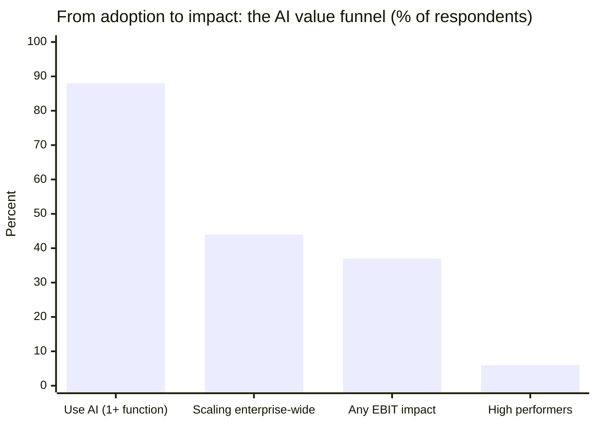
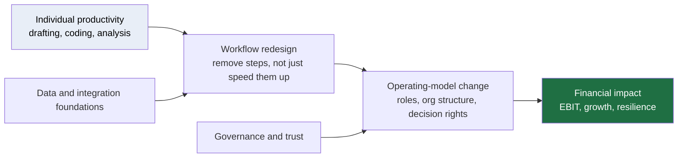
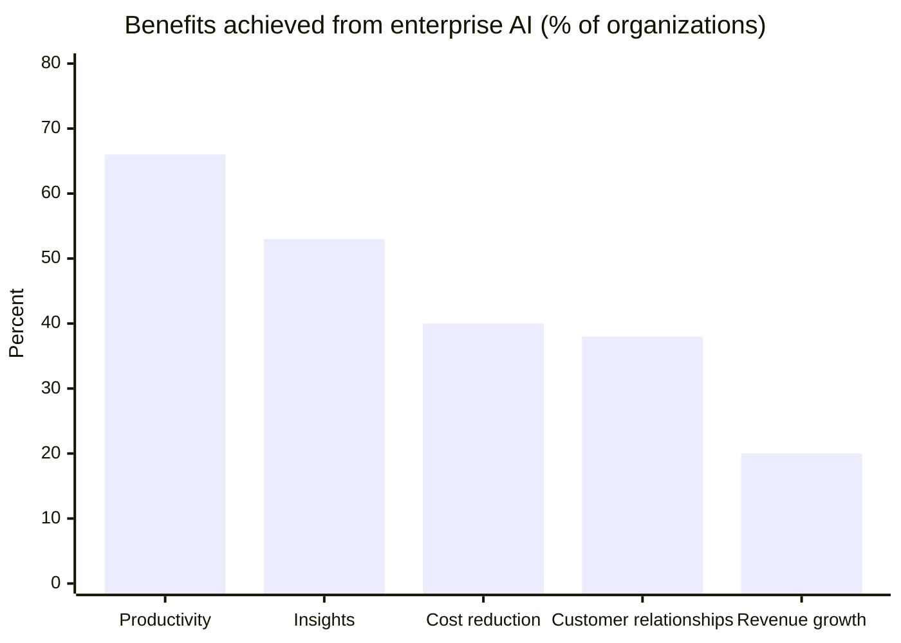
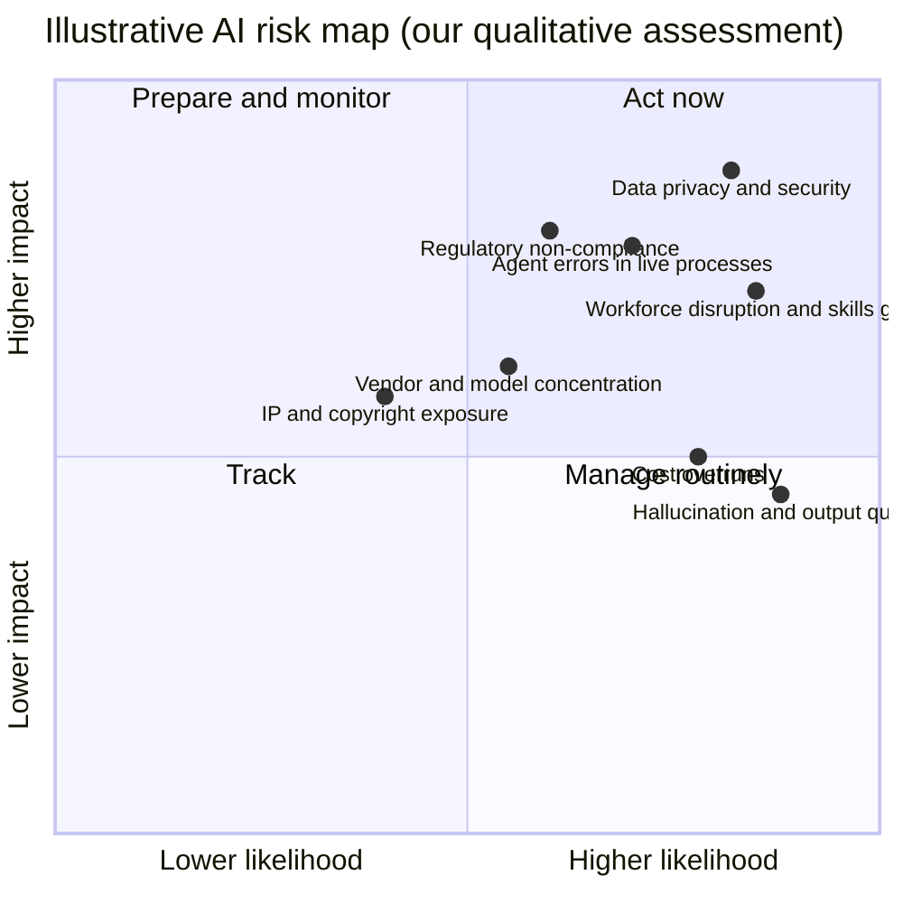
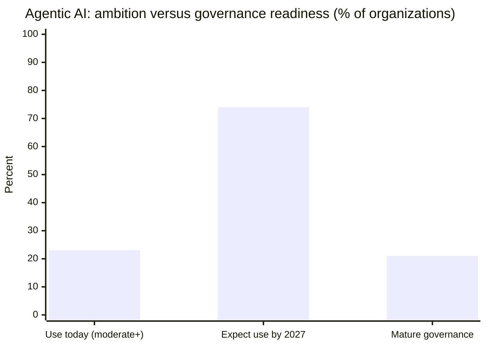
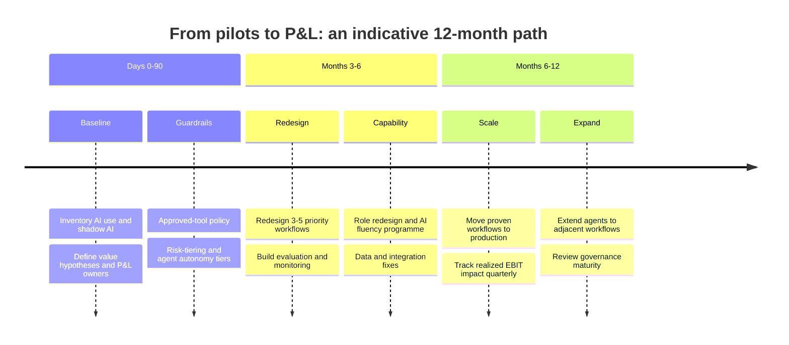

## Executive Summary

Artificial intelligence has crossed the adoption threshold. It has not yet crossed the value threshold. That gap is the defining strategic issue for boards and C-suites heading into 2027.

**Key takeaways**

1. **Adoption is near-universal; impact is not.** Roughly nine in ten organizations use AI in at least one business function. Only about 37% of respondents attribute any EBIT impact to it, a share that has barely moved year over year, and only around 6% qualify as true "high performers."
2. **Individuals win first, enterprises win later.** About 80% of respondents say AI has improved their personal productivity. Those gains are not translating into P&L results because workflows, roles, and operating models have not been redesigned around them.
3. **The next wave is agentic, and it changes the risk profile.** AI is shifting from a tool that advises to an actor that decides and executes. Only about one in five organizations reports a mature governance model for it.
4. **Value follows redesign, not deployment.** The strongest correlate of financial impact is workflow redesign. Buying more licences is not the lever.
5. **The risks are real, specific, and manageable.** Data privacy and security, workforce disruption, model and vendor concentration, regulatory exposure, and runaway costs can all be addressed, but only if governance is built in parallel with deployment rather than after it.

**Our recommendation:** Treat AI as an operating-model transformation, not a technology rollout. Concentrate on a small number of end-to-end workflows, redesign them, instrument them financially, and scale governance at the same pace as autonomy.

---

## 1. The Paradox: Everyone Is Using AI, Few Are Profiting From It

Every technology wave has had its productivity paradox. Economist Robert Solow's famous remark about computers showing up everywhere except in the productivity statistics has an AI-era analogue: AI shows up in every function and almost nowhere in the income statement.

McKinsey's 2026 *State of AI* survey (1,719 respondents, fielded May to June 2026, published August 2026) and Deloitte's *State of AI in the Enterprise* (3,235 leaders across 24 countries, published January 2026) tell a remarkably consistent story.

### The AI value funnel

```text
SHARE OF ORGANIZATIONS / RESPONDENTS (each █ = 2 percentage points)

Use AI in at least one function   ████████████████████████████████████████████  ~88-89%
Scaling AI enterprise-wide        ██████████████████████                          44%
Report any EBIT impact from AI    ██████████████████▌                             37%
"High performers" (≥5% of EBIT)   ███                                             ~6%
```

*Sources: McKinsey, The state of AI in 2026: On the road to ROI (Aug 2026); adoption figure as reported for the 2025 and 2026 waves.*



### The individual-versus-enterprise gap

```text
PERSONAL PRODUCTIVITY IMPROVED   ████████████████████████████████████████  80%
ENTERPRISE EBIT IMPACT           ██████████████████▌                       37%
                                 └──────────── the "last mile" gap ───────┘
```

Why does the gap persist? In our client work we see the same four patterns repeatedly:

- **Task automation without process redesign.** Saving 20 minutes on a memo does not change the cost base if the approval chain around the memo stays the same.
- **Pilot purgatory.** Deloitte found that only about a quarter of enterprise AI leaders had moved 40% or more of their pilots into production, even as worker access to sanctioned AI tools grew by roughly 50% in a year.
- **No financial instrumentation.** Few organizations define, up front, which P&L line an AI initiative is supposed to move, and fewer still measure it.
- **Capability debt.** Data quality, integration, and talent gaps remain the most common reasons a promising prototype stalls.

> *"We thought we were going to automate jobs. The truth is, you're not."*
> **Telecom vice president, quoted in Deloitte's State of AI in the Enterprise 2026**

---

## 2. Where the Value Is: Synergies Across the Enterprise

The value of AI is not located in a single use case. It is located in the **compounding** of capabilities across the value chain.



### Benefits organizations actually report

Deloitte's survey shows a clear hierarchy: efficiency is easy to capture, growth is hard.

```text
BENEFITS ACHIEVED FROM ENTERPRISE AI (% of organizations, each █ = 2 points)

Productivity & efficiency   █████████████████████████████████   66%
Insights & decision-making  ██████████████████████████▌         53%
Cost reduction              ████████████████████                40%
Customer relationships      ███████████████████                 38%
Revenue growth              ██████████                          20%
```

*Source: Deloitte, State of AI in the Enterprise 2026.*



**The strategic read:** most firms are harvesting the efficiency dividend first. The organizations that move early on revenue growth, meaning new products, pricing, personalization, and faster cycle times, will open a competitive gap that cost-cutters cannot close.

### Four synergy engines

| Engine | What it looks like | Why it compounds |
|---|---|---|
| **Decision intelligence** | Forecasting, pricing, risk scoring, and supply planning that update continuously | Better decisions generate better data, which improves the next decision |
| **Agentic workflows** | Software agents that execute multi-step tasks (claims, onboarding, procurement, IT service) with human oversight | Each reusable agent lowers the cost of the next automation |
| **Engineering acceleration** | AI-assisted software development and testing | Faster release cycles raise the pace of every other digital initiative |
| **Customer and employee experience** | Personalized service, knowledge retrieval, and copilots at the point of work | Higher satisfaction and retention reinforce the data advantage |

---

## 3. The Industry Lens: Same Technology, Different Value Pools

AI's impact is not uniform. The table below is our qualitative assessment of where value tends to concentrate and where constraints bind. It is a framework for discussion, not survey data.

| Industry | Primary value pools | Binding constraints |
|---|---|---|
| **Financial services** | Risk and fraud, operations, advisory and service, software engineering | Model risk management, regulatory scrutiny, explainability |
| **Healthcare & life sciences** | Drug discovery, clinical documentation, diagnostics support, administrative burden | Patient safety, privacy, validation and approval pathways |
| **Manufacturing & energy** | Predictive maintenance, quality control, planning, autonomous operations | Operational technology integration, safety-critical reliability |
| **Retail & consumer** | Demand forecasting, personalization, pricing, supply chain | Data fragmentation, brand and customer-trust risk |
| **Technology, media & telecom** | Software development, content operations, network optimization, customer care | Intellectual property, commoditization, talent competition |
| **Public sector** | Case processing, citizen service, fraud detection | Procurement cycles, accountability, equity and transparency |

### Voices from the field

> *"We need to show up with real solutions to real problems."*
> **Satya Nadella, Chairman and CEO, Microsoft, World Economic Forum 2026**

> Jamie Dimon, CEO of JPMorgan Chase, has publicly conceded that AI **"will eliminate jobs"** while urging employees to embrace it.
> **Reported by Fortune, April 2026**

> Jensen Huang, CEO of Nvidia, argues that embracing AI will make workers **"feel superhuman"**, and warns against scaring people about it.
> **Reported by TechRadar, GTC 2026**

> Dario Amodei, CEO of Anthropic, has forecast systems **"better than almost all humans at almost all things"** by 2026 or 2027.
> **Reported by Fortune**

*Note the spread of views. Even leaders who agree on the direction of travel disagree on the pace and on the labor consequences. Boards should plan for a range, not a point estimate.*

**A data point from the front line:** JPMorgan Chase has been reported to spend roughly \$2 billion a year on AI, with management stating the savings are of similar magnitude, and to be targeting more than 1,000 AI use cases in production by the end of 2026 (up from about 450). Whatever one thinks of the exact figures, the signal is that the leaders are instrumenting returns, not just deploying tools.

---

## 4. Challenges and Risks: What Can Go Wrong

### The risk landscape



*Placement is illustrative and will differ by industry and organization.*

### Risk register

| Risk | What it looks like in practice | First-order mitigation |
|---|---|---|
| **Data privacy and security** | Sensitive data leaking into tools; prompt-injection attacks on agents. Deloitte found data privacy and security to be the most-cited AI risk concern (around 73% of respondents). | Data classification, access controls, red-teaming, approved-tool policies |
| **Agent autonomy without oversight** | Agents taking consequential actions (payments, customer commitments) without adequate controls | Tiered autonomy, human-in-the-loop thresholds, full audit trails |
| **Workforce disruption** | Entry-level pipelines hollowed out; uneven skills; morale and trust effects | Role redesign, reskilling at scale, transparent communication |
| **Regulatory exposure** | Divergent rules across jurisdictions; sector-specific obligations | Central AI inventory, risk-tiering, regulatory horizon scanning |
| **Concentration and sovereignty** | Dependence on a few model and cloud vendors; data-residency concerns | Multi-model architecture, exit clauses, sovereign-AI options where relevant |
| **Cost** | Inference and integration costs outrunning the business case | FinOps for AI, unit economics per workflow, usage guardrails |
| **Quality and trust** | Hallucinations and inconsistent outputs eroding user confidence | Evaluation harnesses, grounding in enterprise data, clear escalation paths |

### The governance gap

The most striking finding of 2026 is the speed mismatch between **agent deployment** and **agent governance**.

```text
AGENTIC AI: AMBITION VS. READINESS (% of organizations, each █ = 2 points)

Use agentic AI at least moderately TODAY      ████████████                          23%
Expect to by 2027 (broad definition)          █████████████████████████████████████ 74%
Have a MATURE governance model for agents     ██████████▌                           21%
```



*Source: Deloitte, State of AI in the Enterprise 2026. Definitions vary across Deloitte publications: some cuts put expected moderate-or-greater use within two years nearer 46%, while 74% reflects the share expecting to use agents at least moderately by 2027. Either way, planned use far outruns mature governance.*

Deloitte's finding that the organizations reporting the strongest agentic outcomes are not the fastest movers, but the ones that start with lower-risk use cases and build governance alongside, is, in our experience, the single most actionable insight in the data.

---

## 5. What Separates the Leaders

McKinsey's "high performers," the roughly 6% who attribute at least 5% of EBIT to AI, share a recognizable pattern. Combining that research with what we see in the field:

| Dimension | Typical organization | High performer |
|---|---|---|
| **Ambition** | Efficiency and cost savings | Growth, new offerings, and efficiency |
| **Unit of change** | Individual tasks | End-to-end workflows and decision rights |
| **Ownership** | IT or an innovation lab | Business-line P&L owners, backed by the C-suite |
| **Measurement** | Usage and satisfaction | Financial outcomes tied to specific P&L lines |
| **Autonomy** | All-or-nothing debates | Tiered autonomy with explicit escalation rules |
| **Governance** | Post-hoc review | Built in from design, scaled with autonomy |
| **Talent** | Training programmes | Role redesign plus "AI fluency" across the workforce |

---

## 6. A Practical Playbook

### Five moves for the next 12 months

1. **Pick three to five workflows, not fifty use cases.** Choose end-to-end processes with a clear P&L line (for example claims handling, procurement-to-pay, customer onboarding, software delivery).
2. **Redesign before you automate.** Ask which steps should disappear, not which steps can be sped up.
3. **Put a financial owner on every initiative.** No business owner, no budget.
4. **Tier your autonomy.** Define what agents may do alone, what needs approval, and what stays human. Review the tiers quarterly.
5. **Invest in the foundations.** Data quality, integration, evaluation tooling, and AI fluency are unglamorous and decisive.

### Indicative roadmap



### Ten questions for the board

1. Which three P&L lines will AI move in the next 12 months, and who owns each one?
2. What share of our AI spend is tied to a redesigned workflow versus a bolted-on tool?
3. Where are agents already acting on our behalf, and under what controls?
4. How would we know if an agent made a material error before a customer or regulator did?
5. What is our AI cost per unit of business output, and how is it trending?
6. Which critical processes depend on a single model or vendor?
7. What is our plan for entry-level roles and the future talent pipeline?
8. Which regulations apply to us, and where is our central inventory of AI systems?
9. How do we measure trust: employee, customer, and regulator?
10. If our largest competitor halved its cost-to-serve using AI, what would we do in 90 days?

---

## 7. Outlook: Three Scenarios to Plan Against

| Scenario | Description | Implication |
|---|---|---|
| **Steady scaling** | Gradual agent adoption; governance keeps pace; value concentrates among organizations that redesign workflows | Reward patience and discipline; the gap between leaders and laggards widens slowly |
| **Rapid capability leap** | Agentic systems improve faster than expected; workforce effects arrive earlier | Reskilling, org redesign, and governance must accelerate; early movers gain outsized advantage |
| **Trust shock** | A high-profile agent failure or security incident triggers regulatory and customer backlash | Strong governance becomes a competitive asset; weak governance becomes an existential liability |

Rather than betting on one, resilient organizations build **no-regret capabilities**: clean data, flexible architecture, redesigned workflows, strong governance, and an AI-fluent workforce, that pay off in all three.

---

## Conclusion

The question for 2027 is no longer "should we adopt AI?" Nearly everyone already has. The question is whether adoption will be converted into advantage, and the evidence says that conversion is the exception today, not the rule. The roughly 6% who are capturing disproportionate value did not get there with better tools. They got there by redesigning how work gets done, measuring what matters, and governing autonomy as carefully as they deploy it.

That is available to any organization willing to treat AI as what it is: not a technology project, but a new way of running the business.

---

## Sources and Methodology Notes

- McKinsey & Company, *The state of AI in 2026: On the road to ROI* (August 2026): survey of 1,719 participants across 97 countries, fielded 4 May to 8 June 2026. [https://www.mckinsey.com/capabilities/quantumblack/our-insights/the-state-of-ai](https://www.mckinsey.com/capabilities/quantumblack/our-insights/the-state-of-ai)
- Deloitte AI Institute, *State of AI in the Enterprise: The Untapped Edge* (January 2026): 3,235 leaders in 24 countries. [https://www.deloitte.com/us/en/what-we-do/capabilities/applied-artificial-intelligence/content/state-of-ai-in-the-enterprise.html](https://www.deloitte.com/us/en/what-we-do/capabilities/applied-artificial-intelligence/content/state-of-ai-in-the-enterprise.html)
- Deloitte Insights, *AI agents scaling faster*. [https://www.deloitte.com/global/en/insights/topics/emerging-technologies/ai-agents-scaling-faster.html](https://www.deloitte.com/global/en/insights/topics/emerging-technologies/ai-agents-scaling-faster.html)
- Executive quotes and commentary as reported by Fortune (1 April 2026), TechRadar (GTC 2026), Techloy (Davos 2026 coverage), and Fortune (October 2025).
- JPMorgan figures as reported by Enterprise DNA, citing Bloomberg.
